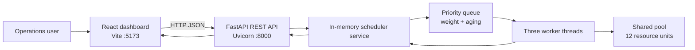

# Fulfill — Order Fulfillment Control Center

A full-stack order fulfillment operations demo built on the multithreaded priority scheduler. It represents an online store's back-office workflow: verify payments, reserve inventory, pick and pack orders, review fraud, create shipping labels, and book carriers.

The FastAPI backend accepts work through a REST API and dispatches it to concurrent Python worker threads. A React dashboard displays the live task queue, task priorities, worker activity, resource utilization, and operational metrics. Tasks can be added from the UI or API.

> **Demo scope:** tasks, events, and metrics are stored in process memory. Restarting the backend clears them and loads a fresh sample batch. This is a local development project, not a production order management service.

## Contents

- [Features](#features)
- [Technology](#technology)
- [Architecture](#architecture)
- [Requirements](#requirements)
- [Run locally](#run-locally)
- [Use the dashboard](#use-the-dashboard)
- [REST API](#rest-api)
- [Scheduling and task lifecycle](#scheduling-and-task-lifecycle)
- [Configuration](#configuration)
- [Legacy console simulation](#legacy-console-simulation)
- [Project layout](#project-layout)
- [Troubleshooting](#troubleshooting)
- [Limitations and production considerations](#limitations-and-production-considerations)

## Features

- **Real-world workflow:** fulfillment tasks for payment, inventory, packing, fraud, and shipping operations.
- **Concurrent execution:** three backend worker threads process jobs concurrently.
- **Priority scheduling:** `HIGH` tasks are selected before `MEDIUM`, then `LOW`; task weight breaks ties.
- **Starvation prevention:** waiting jobs are promoted every 15 seconds, up to `HIGH` priority.
- **Resource-aware dispatch:** a worker starts a queued task only when its resource units are available. A task that does not fit does not block other tasks that do.
- **Live operations view:** React dashboard automatically refreshes every 2.5 seconds and displays queue, activity, worker, and resource metrics.
- **Task management:** create tasks from the UI, search/filter the queue, and load another demo batch.
- **API validation and docs:** FastAPI validates task input and exposes interactive OpenAPI documentation.
- **Original simulation preserved:** the original standalone producer-consumer scheduler remains runnable from the project root.

## Technology

| Area | Tools |
| --- | --- |
| API | Python 3.10+, FastAPI, Pydantic, Uvicorn |
| Scheduler | Python threads, condition variable, in-memory task queue |
| Frontend | React 19, Vite 8, Lucide React |
| Browser/API communication | JSON over HTTP; CORS configured for Vite localhost origins |

## Architecture



The UI requests dashboard metrics and task data from the API. The service protects the task store, queue, resource pool, and activity feed with a condition lock. Worker threads reserve resources before execution and release them when a job completes.

## Requirements

- Python 3.10 or newer.
- Node.js 20.19+ or 22.12+ and npm (required by Vite 8).
- Git (to clone the repository).

## Run locally

Clone the repository and change to its directory:

```powershell
git clone https://github.com/mohaneshwarishanmugaraj-arch/multithreaded-priority-task-scheduler.git
cd multithreaded-priority-task-scheduler
```

Keep the backend and frontend running in separate terminals.

### 1. Install and run the backend

**Windows PowerShell:**

```powershell
python -m venv .venv
.\.venv\Scripts\Activate.ps1
python -m pip install -r requirements.txt
python -m uvicorn backend.main:app --reload --port 8000
```

If PowerShell blocks local activation scripts, either enable activation for your user as appropriate for your environment, or call the virtual environment interpreter directly:

```powershell
.\.venv\Scripts\python.exe -m pip install -r requirements.txt
.\.venv\Scripts\python.exe -m uvicorn backend.main:app --reload --port 8000
```

**macOS/Linux:**

```bash
python3 -m venv .venv
source .venv/bin/activate
python -m pip install -r requirements.txt
python -m uvicorn backend.main:app --reload --port 8000
```

The API is at `http://localhost:8000`. Interactive Swagger docs are at `http://localhost:8000/docs`; ReDoc is at `http://localhost:8000/redoc`.

### 2. Install and run the frontend

In a second terminal, from the repository root:

```bash
cd frontend
npm install
npm run dev
```

Open the local Vite URL printed in that terminal, normally `http://localhost:5173`. The API starts with nine sample fulfillment tasks, which execute automatically. Use **Create task** to submit a work item or **Load demo orders** to add another batch.

### Frontend API URL

The UI defaults to `http://localhost:8000`. To point it at another API origin, create `frontend/.env.local` (this file is ignored by Git) with:

```text
VITE_API_URL=http://localhost:8000
```

Restart the Vite development server after changing environment variables. If using a non-local origin, update the backend CORS allow list in `backend/main.py` too.

### Production frontend build

```bash
cd frontend
npm run build
npm run preview
```

Vite writes production assets to `frontend/dist/`; preview serves that build locally. The frontend build has been verified with `npm run build`.

## Use the dashboard

- **Overview cards:** completed tasks, active workers, queued work, and current resource use.
- **Priority distribution:** queued and running task counts for each priority level.
- **Processing snapshot:** average wait/run durations, worker count, and free resource units.
- **Fulfillment queue:** filter by queued/running/completed status, search by order/task/priority, and inspect assigned worker.
- **Live activity:** recent queued, started, completed, and priority promotion events.
- **Create task:** specify an optional order ID, workflow task type, priority, weight, resource units, and execution duration.

## REST API

All endpoints return JSON. The backend uses CORS for `http://localhost:5173` and `http://127.0.0.1:5173` by default.

| Method | Endpoint | Success | Purpose |
| --- | --- | --- | --- |
| `GET` | `/api/health` | `200` | Health check |
| `GET` | `/api/dashboard` | `200` | Dashboard counters, priority breakdown, performance measures, and recent activity |
| `GET` | `/api/tasks` | `200` | List tasks, newest first |
| `GET` | `/api/tasks?status=QUEUED` | `200` | Filter tasks; allowed statuses: `QUEUED`, `RUNNING`, `COMPLETED` |
| `POST` | `/api/tasks` | `201` | Validate and add one task to the queue |
| `POST` | `/api/demo/seed` | `200` | Add up to nine sample tasks |

Interactive request/response schemas are available at `/docs` while the backend is running.

### Create-task request

`POST /api/tasks` with `Content-Type: application/json`:

```json
{
  "order_id": "ORD-2409",
  "task_type": "Pick & pack",
  "priority": "HIGH",
  "weight": 8,
  "resource_units": 3,
  "execution_seconds": 6
}
```

Fields and validation:

| Field | Type | Required | Allowed/default |
| --- | --- | --- | --- |
| `order_id` | string or `null` | No | 3–32 characters; generated automatically when omitted or `null` |
| `task_type` | string | Yes | `Payment verification`, `Inventory reservation`, `Pick & pack`, `Fraud review`, `Shipping label`, `Carrier booking` |
| `priority` | string | No | `HIGH`, `MEDIUM`, `LOW`; defaults to `MEDIUM` |
| `weight` | integer | No | 1–10; defaults to 5 |
| `resource_units` | integer | No | 1–8; defaults to 2 |
| `execution_seconds` | integer | No | 1–30; defaults to 5 |

A successful response includes the generated task `id`, current `status`, timestamps, requested and current priority, and assigned `worker` once execution starts. Invalid data returns FastAPI's validation response. The service accepts up to 100 waiting tasks; when the queue is full, task creation returns `429`.

### Dashboard response fields

`GET /api/dashboard` includes:

- `orders_processed`, `active_tasks`, `queued_tasks`, and `total_tasks`.
- `workers_online`.
- `resource_utilization`, `resources_in_use`, and `total_resources`.
- `priority_promotions`, `avg_wait_seconds`, and `avg_run_seconds`.
- `priority_breakdown` for open (queued and running) work.
- `activity`, the latest scheduler events with IDs, source labels, and UTC timestamps.

## Scheduling and task lifecycle

A task moves through `QUEUED` → `RUNNING` → `COMPLETED`. When the API starts, it starts three daemon worker threads and inserts the demo batch.

1. New tasks enter the shared in-memory queue.
2. Workers wait on a condition variable until there is a task they can run.
3. The scheduler selects by priority (`HIGH` > `MEDIUM` > `LOW`), then higher weight, then earlier creation time.
4. A task starts only if its required units fit in the currently available pool of 12 units. Other fitting work remains eligible even if an earlier queued task cannot currently fit.
5. Waiting tasks gain one priority level per 15 seconds, capped at `HIGH`.
6. On completion, the worker returns the task's resource units and records wait time, execution time, and activity.

Execution duration is simulated with a sleep; these tasks do not connect to a payment provider, inventory system, warehouse, or carrier.

## Configuration

The API scheduler's demo and worker settings are currently constants in `backend/scheduler_service.py`:

- `worker_count=3` when constructing `SchedulerService`.
- `TOTAL_RESOURCES = 12`.
- `MAX_QUEUED_TASKS = 100` waiting tasks.
- `AGING_SECONDS = 15`.
- `seed_demo()` defines the sample jobs and their attributes.

The original console simulation remains separately configured in `configuration.py`:

| Setting | Default | Description |
| --- | ---: | --- |
| `NUM_PRODUCERS` | 2 | Producer threads |
| `NUM_WORKERS` | 2 | Worker threads |
| `TASKS_PER_PRODUCER` | 10 | Tasks created by each producer |
| `BUFFER_SIZE` | 10 | Bounded task buffer |
| `AGING_TIME` | 10 seconds | Console simulation priority aging |
| `TOTAL_RESOURCES` | 10 | Console simulation resource pool |
| `MIN_EXECUTION_TIME` / `MAX_EXECUTION_TIME` | 1 / 5 seconds | Random task duration bounds |

## Legacy console simulation

Run from the repository root:

```bash
python main.py
```

This runs the original standalone producer-consumer simulation, writes timestamped logs to the console, and prints end-of-run statistics. It is independent from the FastAPI process and its dashboard data.

## Project layout

```text
.
├── backend/
│   ├── main.py                 # FastAPI app, validation models, routes, startup/shutdown
│   └── scheduler_service.py    # In-memory store, queue, worker threads, metrics
├── frontend/
│   ├── index.html              # Vite HTML entry
│   ├── package.json            # Frontend scripts and dependencies
│   └── src/
│       ├── App.jsx             # Dashboard, polling, filters, task form
│       ├── main.jsx            # React entry point
│       └── styles.css          # Responsive dashboard styles
├── configuration.py            # Legacy simulation settings
├── main.py                     # Legacy simulation entry point
├── producer.py                 # Legacy task producers
├── scheduler.py                # Legacy priority queue scheduler
├── worker.py                   # Legacy workers
├── resource.py                 # Legacy shared resources
├── task.py                     # Legacy task model
├── statics.py                  # Legacy run statistics
├── logger.py                   # Legacy thread-safe logger
└── requirements.txt            # Python API dependencies
```

## Troubleshooting

- **Dashboard shows “API disconnected”:** confirm Uvicorn is running on port `8000`, then open `http://localhost:8000/api/health` and refresh the dashboard.
- **API starts but frontend cannot connect:** check the `VITE_API_URL` value and ensure the frontend origin is present in the FastAPI CORS allow list.
- **Port is already in use:** choose another Uvicorn port (for example, `--port 8001`) and set `VITE_API_URL` to the matching API origin; choose a different Vite port with `npm run dev -- --port 5174`.
- **Python dependency/import errors:** activate the intended `.venv`, then run `python -m pip install -r requirements.txt` using that environment's interpreter.
- **Frontend install/build errors:** verify the Node.js version meets the Vite requirement, then run `npm install` from `frontend/` before `npm run build`.
- **PowerShell activation is blocked:** use the direct `.venv\Scripts\python.exe` commands above rather than changing machine-wide execution policy.

## Limitations and production considerations

This is a learning/demo application. Before using a similar design for actual orders, consider adding:

- Durable task and event storage (for example, PostgreSQL) and a persistent queue for restart/retry guarantees.
- Authentication, authorization, audit history, input rate limits, and secrets/configuration management.
- Idempotency keys and duplicate order/task handling.
- Retry policies, failure/dead-letter states, cancellation, and graceful draining at shutdown.
- Metrics/structured logs, tracing, health/readiness checks, and deployment monitoring.
- A production UI/API deployment configuration, HTTPS, and environment-specific CORS origins.
